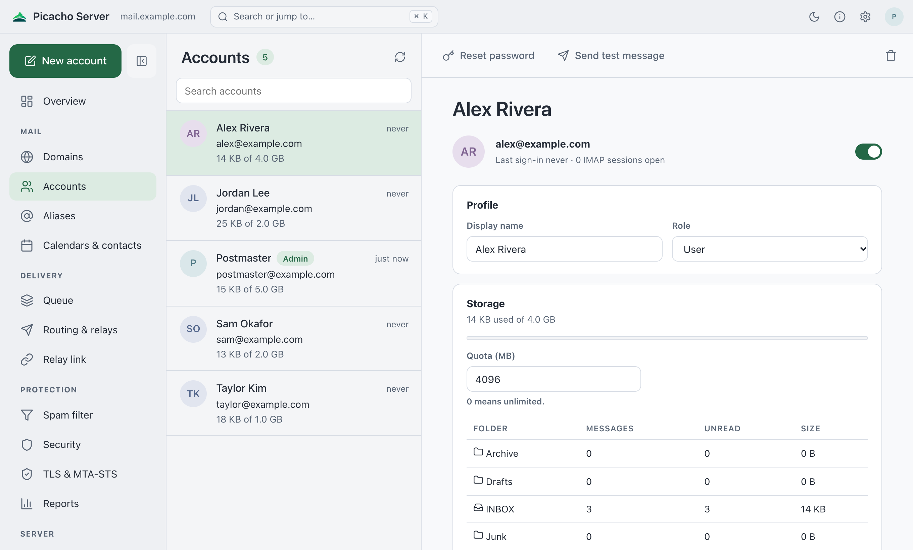
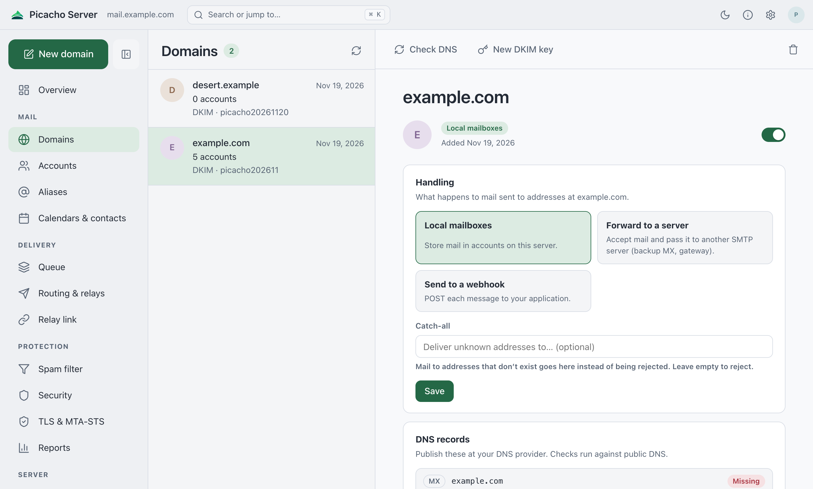

<p align="center">
  
</p>

<h1 align="center">Picacho Server</h1>

<p align="center"><strong>A secure, fast mail server for every domain you have.</strong></p>

<p align="center">
  <a href="https://github.com/pinaltech/Picacho-Server/actions/workflows/ci.yml"></a>
  <a href="LICENSE"></a>
  <a href="Cargo.toml"></a>
</p>

<p align="center">Made by <a href="https://pinal.tech">Pinal Technologies</a> with ❤️</p>

<picture>
  <source media="(prefers-color-scheme: dark)" srcset="docs/screenshots/accounts-dark.png">
  
</picture>

<picture>
  <source media="(prefers-color-scheme: dark)" srcset="docs/screenshots/domain-dark.png">
  
</picture>

<sub>Screenshots use sample accounts on example.com.</sub>

Picacho Server is a mail server written in Rust: IMAP, JMAP, SMTP (MX and submission), CalDAV, CardDAV and WebDAV, outbound relaying and webhooks in one binary. It comes with a Svelte postmaster console designed after the [Picacho](https://github.com/pinaltech/Picacho) mail app, with light and dark palettes and Picacho's accent colors.

## Features

- **IMAP4rev1 and IMAP4rev2** (RFC 9051, after `ENABLE IMAP4rev2`: ESEARCH replies, no \\Recent, UTF-8 names) with LITERAL+, SASL-IR, IDLE, NAMESPACE, UIDPLUS, MOVE, UNSELECT, CHILDREN, SPECIAL-USE, CREATE-SPECIAL-USE, ID, ENABLE, **CONDSTORE, QRESYNC, ESEARCH, ESORT, SORT, SORT=DISPLAY, THREAD=ORDEREDSUBJECT, THREAD=REFERENCES, BINARY, MULTIAPPEND, CATENATE, LIST-EXTENDED, LIST-STATUS, QUOTA, WITHIN, STATUS=SIZE, OBJECTID, SAVEDATE, PREVIEW, APPENDLIMIT, REPLACE, SEARCHRES, UTF8=ACCEPT (with UTF-8 APPEND), UIDONLY, PARTIAL, NOTIFY, URLAUTH, MULTISEARCH, SEARCH=FUZZY, METADATA-SERVER, JMAPACCESS**. MOVE within an account keeps each message's EMAILID. Mailbox names are stored in modified UTF-7, so UTF-8 and older clients see the same folders. Passes Dovecot's **imaptest** suite (0/460 base-protocol and 0/266 extension failures) and its multi-client stress test with no consistency errors.
- **JMAP** (RFC 8620 core, RFC 8621 mail, submission, RFC 9425 quota, RFC 9404 blob, RFC 9007 MDN): Mailbox, Email (get/query/set/changes/import/parse), Thread, Identity (get/set/changes), EmailSubmission (get/query/set/changes, with **send later** through `HOLDUNTIL`/`HOLDFOR`, **undo** while held, and per-recipient `deliveryStatus`), SearchSnippet, Quota (get/query), Blob/upload, ranged Blob/get with digests, Blob/lookup, MDN/send and MDN/parse (read receipts), Email/queryChanges, result references, uploads/downloads, EventSource push and **JMAP over WebSocket** (RFC 8887, with push). **JMAP for Calendars and Contacts** (Calendar, CalendarEvent, AddressBook, ContactCard: get/set/changes/query/queryChanges/copy, CalendarEvent/parse, ParticipantIdentity) and **Principals** (RFC 9670: get/query/set, getAvailability) work on the same data CalDAV and CardDAV serve: JSCalendar/JSContact are converted to and from iCalendar/vCard, and a JMAP change keeps what the iCalendar or vCard held that JSON doesn't describe. Session at `/.well-known/jmap`.
- **Admin REST API** at `/api/v1` with an OpenAPI 3.1 document: accounts, domains, aliases, queue and settings, authenticated with scoped API tokens. The same tokens work as **app passwords** for IMAP/SMTP (`mail` scope) and for JMAP (`jmap` scope).
- **SMTP** inbound (port 25) with SPF/DKIM/DMARC verification, DNSBL and reverse-DNS checks, and authenticated submission (587 STARTTLS, 465 TLS) with DKIM signing, sender-ownership enforcement and per-user rate limits. Submissions can be **held and sent later** (FUTURERELEASE, RFC 4865: `HOLDFOR`/`HOLDUNTIL`, up to `limits.max_hold_days`, 31 by default), even to local recipients; held messages show up as pending JMAP submissions and can be canceled. EHLO advertises `LIMITS RCPTMAX` (RFC 9422), **BURL imap** (RFC 4468: send a message straight from an IMAP mailbox with a URLAUTH `submit+` URL), BINARYMIME, **DELIVERBY** (RFC 2852: undelivered mail past its deadline is returned, and BY= is passed on) and **MT-PRIORITY** (RFC 6710).
- **Kerberos sign-in** (SASL GSSAPI, RFC 4752) for IMAP, SMTP, POP3 and ManageSieve with `[kerberos]` in config.toml (keytab, realm, mailbox domain). The system's GSS-API library is loaded at run time, so builds need no Kerberos headers. `user@REALM` signs in to `user@<domain>`; service and admin principals never sign in.
- **POP3** (RFC 1939) with CAPA, STLS, SASL (PLAIN, XOAUTH2, OAUTHBEARER, GSSAPI), UIDL, TOP, RESP-CODES, UTF8 and LANG, off unless `listen.pop3`/`listen.pop3s` are set. Sessions see the inbox as of sign-in; DELE removes only once QUIT confirms.
- **Encryption at rest to the owner's key** (Pinal Mail's zero-access encryption): give an account an OpenPGP public key (account page, `PUT /api/v1/me/encryption`, or `encryption_key` when an admin creates or updates the account) and mail delivered to it is stored as PGP/MIME, its headers outside and its body encrypted to that key (SEIPD, AES-256, uncompressed), the format the Picacho app opens. Filters run first; mail its sender already encrypted is kept as it came; what the owner files themselves (drafts, sent copies) isn't encrypted. The server can't read encrypted mail, so body search doesn't find it.
- **Delivery**: direct MX, any number of SMTP relays (SES, SendGrid, Mailgun, Postmark, Resend, Brevo, Google Workspace, …), HTTP webhooks with HMAC signatures, per-domain routing rules, retries with backoff, bounces (DSNs).
- **Receiving modes per domain**: local mailboxes, forward everything to another SMTP server (gateway / backup MX), or POST to a webhook. Aliases, catch-alls, plus-addressing and per-account forwarding (with SRS so SPF still passes).
- **Storage**: SQLite or PostgreSQL for metadata; local disk, any S3-compatible store, or the database for messages; optional separate store for large attachments (deduplicated across all mailboxes); live settings in the database or a TOML file; optional AES-256-GCM encryption at rest.
- **Web console**: onboarding wizard; navigation grouped into Mail (domains with DNS records and live checks, accounts, aliases), Delivery (queue, routing & relays) and Server (security, storage & limits, **Configuration**, **API & tokens**, activity); a ⌘K/Ctrl+K command palette to jump to any page, account, domain or alias; light/dark themes and Picacho's accent colors.
- **Single sign-on (OpenID Connect)** for everyone who uses the console, administrators and mailbox users alike. Identities are linked by issuer + subject; mailboxes can be created on first sign-in, and an admin-groups claim decides who's an administrator. Password sign-in can be turned off (break-glass: `PICACHO_ALLOW_PASSWORD_LOGIN=1`), separately for the console and for mail apps.
- **Access tokens from your identity provider** (e.g. Pinal Accounts): Picacho issues no OAuth tokens of its own. Apps get JWT access tokens from the provider (which shows the consent screen and lists connected apps) for this server's resource identifier; Picacho verifies them against the provider's JWKS and maps capability scopes (`mail.read`, `mail.send`, `calendar.write`, …) onto IMAP, SMTP, JMAP, CalDAV, CardDAV, ManageSieve and the REST APIs. They work as Bearer tokens and with IMAP/SMTP `XOAUTH2`/`OAUTHBEARER`; protected-resource metadata (RFC 9728) is at `/.well-known/oauth-protected-resource`.
- **Branding**: name, logo, accent color, sign-in message and support links, applied to the console, sign-in and consent pages.
- **Delivery security**: outbound MX delivery honors **MTA-STS** (RFC 8461) and **DANE** (RFC 7672, DNSSEC-validated TLSA), sends **SMTP TLS reports** (RFC 8460), and supports **REQUIRETLS** (RFC 8689), **DSN** (RFC 3461/3464: success, delay, failure, relayed), **CHUNKING/BDAT**, PIPELINING and SMTPUTF8. Forwarded mail is **ARC-sealed**; inbound ARC is verified. **DMARC aggregate reports** are sent to domains that ask, and incoming DMARC/TLS reports are parsed for the console. **ACME** (Let's Encrypt, HTTP-01) issues and renews certificates; every listener picks up new certificates without a restart. Our own MTA-STS policy is served at `mta-sts.<domain>`.
- **Content filtering**: a built-in scorer (authentication results, rDNS/HELO, score-only DNSBLs, URI block lists, header heuristics, link/display mismatches, custom regex rules, sender allow/block lists), a **Bayesian classifier** trained when people move mail into or out of Junk (IMAP and JMAP, `$junk`/`$notjunk`), blocked attachment types (also inside zips), optional **rspamd** and **ClamAV** (clamd), and **greylisting**. Junk and reject thresholds; `X-Spam-*` headers.
- **Sieve** (RFC 5228) with fileinto, reject/ereject, envelope, imap4flags, body, variables, vacation (+seconds), relational, subaddress, copy, regex, date, index, mailbox, spamtest/virustest, include and encoded-character, managed over **ManageSieve** (RFC 5804, port 4190), **JMAP SieveScript** (RFC 9661) or the account API. **Vacation replies** (JMAP VacationResponse) follow RFC 5230's rules (no replies to lists, bulk or auto-submitted mail; once per sender per period).
- **Built for the Picacho app**: every extension above that Picacho uses (see its `docs/SYNCHRONIZATION.md`) is implemented, and `tests/client_extensions.rs` checks them the way the app uses them.
- **IMAP extras**: **ACL** (RFC 4314) with shared folders under `Shared/<owner>/…`, **METADATA** (RFC 5464), **COMPRESS=DEFLATE** (RFC 4978), and a **full-text index** (SQLite FTS5 trigram or PostgreSQL pg_trgm) that narrows SEARCH BODY/HEADER without changing results.
- **WebDAV, CalDAV, CardDAV** at `/dav/`: files, calendars (recurrence expansion, time-range and free-busy queries, floating times in the calendar's zone, **free/busy lookups of other people through the scheduling outbox** (RFC 6638: busy times only, `dav.free_busy_lookup`)) and address books; sync-collection, ctag, quotas, locks, extended MKCOL. A DAV account can be **linked to a mail account** (same sign-in, optional separate DAV password) or **standalone** (own user name and password). Files, calendars and contacts each have their own store (`[storage.dav.*]`).
- **Client autoconfiguration**: Thunderbird autoconfig, Outlook Autodiscover, Apple configuration profiles (`/.well-known/picacho/mobileconfig?email=`), `/.well-known/caldav|carddav`, and DNS record suggestions (SRV, MTA-STS, TLS-RPT, TLSA).
- **Picacho relay link**: run a server where port 25 is blocked and pair it with a public Picacho server over HTTPS. The upstream is MX for the downstream's domains and holds their mail until the downstream pulls it; outbound mail goes out through the upstream. See *Relay link* below.
- **Operations**: graceful shutdown (sessions get BYE/421, deliveries finish), Prometheus `/metrics`, `/healthz` and `/readyz`, an **audit log** of every admin and account API change, retention (Trash/Junk/per-folder), a two-pass **orphaned-object sweep**, account **export/import** (zip, Maildir, mbox), **IMAP migration** from another server, and whole-server **backup/restore**.
- **Configuration from the console**: everything in `config.toml` (listeners, TLS certificate, database, message/attachment stores, encryption, live-settings location, process limits, logging, DNS) can be edited as forms or as raw TOML. Saves are validated, keep a `.bak`, write only non-default values, and a "Restart now" button applies them.

## Quick start

```bash
cd web && npm ci && npm run build && cd ..
```

The console is built into `web/dist` and embedded in the binary at compile time. `web/dist` isn't committed: without it the server still builds and runs, and the console URL shows how to build it.

```bash
cargo run --release
```

No config file is needed. On start the server prints the console address and a one-time **access key**:

```
  ▲ Picacho Server is not set up yet

  Open the web console to create the admin account:
    http://localhost:8080/setup

  Access key:  Q83CC-6P2E5-V5RJQ-NU8Y7-QT5KZ
  A new key is printed on every start until setup is complete.
```

Open the URL, enter the key, and the wizard walks through:

1. **Storage**: data directory, SQLite or PostgreSQL, where messages and attachments go (local, S3, database), encryption. A **Test** button writes, reads and deletes a probe object; if anything changed, the server restarts into it and setup continues with the same key.
2. **Server**: host name and mail domain.
3. **Sign-in**: email and password, or single sign-on (shows the redirect URI to register, checks the provider), and whether passwords stay allowed.
4. **Outgoing mail**: direct delivery or a relay.
5. **Administrator**: with SSO, "Create and sign in with …" links your identity to the admin mailbox, so no password account is ever created.

The key is required, checked in constant time, rate-limited, and invalid after setup.

Ports below 1024 need root or `CAP_NET_BIND_SERVICE`; for local work use the bundled dev config:

```bash
cargo run -- --config config.dev.toml
```

## Configuration

`config.toml` has **no required fields**. Everything is optional and documented in [config.example.toml](config.example.toml): listeners, TLS certificate, where the database / messages / attachments / live settings go, encryption, logging and process limits. It can be edited from the console (Server → Configuration) and applied with a restart button. Things a postmaster changes day to day (relays, routes, retry policy, security policy, size limits, quotas) live in **live settings**, which apply immediately without a restart.

Examples:

```toml
# Everything on one machine (the default)
[storage]
data_dir = "/var/lib/picacho"
encrypt = true

# PostgreSQL + S3, attachments split out to a cheaper bucket
[storage.database]
kind = "postgres"
url_file = "/run/secrets/db-url"

[storage.messages]
kind = "s3"
s3 = { bucket = "mail", region = "eu-central-1" }

[storage.attachments]
kind = "s3"
threshold_bytes = 65536
s3 = { bucket = "mail-attachments", region = "eu-central-1" }

[storage.settings]
kind = "file"
path = "/etc/picacho/live.toml"
```

CLI:

```bash
picacho-server --config /etc/picacho/config.toml        # serve (default)
picacho-server --config /etc/picacho/config.toml check-config
echo 'New-Passphrase-123' | picacho-server passwd alex@example.com
picacho-server backup /var/backups/picacho          # database (JSON lines) + every stored object
picacho-server restore /var/backups/picacho         # into an empty data directory/database
picacho-server export alex@example.com alex.zip     # mail, filters, vacation, calendars, contacts, files
picacho-server import alex@example.com old.mbox --folder Archive   # also export zips and zipped Maildirs
picacho-server renew-cert                           # ACME now
```

## APIs

**REST** — create a token with the `admin` scope under API & tokens, then:

```bash
curl -H "Authorization: Bearer $TOKEN" https://mail.example.com:8080/api/v1/accounts
```

```bash
curl -H "Authorization: Bearer $TOKEN" -H "Content-Type: application/json" -d '{"email":"sam@example.com","password":"A-long-passphrase","quota_mb":2048}' https://mail.example.com:8080/api/v1/accounts
```

Accounts are addressed by id or email (`/api/v1/accounts/sam@example.com`), domains by id or name. The full specification is served at `/api/v1/openapi.json`.

**JMAP** — point a client at `https://mail.example.com:8080/.well-known/jmap` and sign in with the account password, an app password, or a Bearer token with the `jmap` scope. Each email belongs to exactly one mailbox (`maxMailboxesPerEmail: 1`), mirroring IMAP folders.

**Access tokens** — turn on *Sign-in & access → Access for apps* (live settings `auth.oidc.access_tokens` and `auth.oidc.resource`). Apps request the resource identifier from the identity provider (`resource=`; Pinal Accounts adds it for mail, contacts and calendar scopes) and send the JWT as a Bearer token. Scopes: `mail.read` (read-only IMAP/JMAP), `mail.read` + `mail.labels` + `mail.compose` (full IMAP/JMAP), `mail.send` (SMTP), `mail.settings` (Sieve, forwarding, vacation), `calendar.read`/`.write` (CalDAV), `contacts.read`/`.write` (CardDAV). Apps can never create app passwords, export a mailbox or start migrations. The token's `sub` picks the mailbox it is linked to.

**Directory (LDAP)** — turn on *Sign-in & access → Directory (LDAP)* (live settings `auth.ldap`) to check passwords against OpenLDAP, Active Directory, FreeIPA, LLDAP or any LDAP server, for the console (`web_login`) and for IMAP, SMTP, JMAP, CalDAV/CardDAV and ManageSieve (`mail_login`). People sign in with their address or directory user name. Picacho either searches with a service account (or anonymously) and then binds as the user, or binds directly with a DN template (`uid={user},ou=people,…` or `{user}@corp.example.com`). The entry's `mail` attribute picks the mailbox. Optionally, mailboxes are created on first sign-in, `admin_groups` set the role and `required_groups` limit who may sign in (groups come from `memberOf` and/or a group search). Use ldaps:// or StartTLS; plain ldap:// is refused unless it's to localhost or you allow it explicitly. When the directory knows a user, its password decides. Accounts it doesn't know, such as a break-glass admin, keep their local password while local passwords are allowed. LDAP works next to single sign-on and access tokens on the same mailbox, so someone can use SSO in the console, their directory password in a desktop mail app and a Pinal token in a mobile app. Successful logins are cached for 5 minutes, and changing any LDAP setting clears the cache. *Test* (`POST /api/admin/ldap/test`) tries unsaved settings and shows what a user resolves to.

**Contact directory** — turn on *Calendars & contacts → Contact directory* (live settings `directory`) to give each person a read-only **Directory** address book: over CardDAV at `/dav/addressbooks/<me>/directory/`, next to their own books, and over JMAP for Contacts as address book `bdir` (cards can be copied into one's own books). Contact search in calendar and contacts apps finds the same people, including those who haven't used calendars or contacts yet. Picacho remembers what each person's directory last held, so contacts apps sync only what changed (people who are no longer visible are removed), and JMAP push (WebSocket and EventSource, which now honors `types=`) announces changes within a few seconds; JMAP reports people who just became visible as created and doesn't mention people who came and went in between. Groups come from the identity provider's groups claim, from LDAP groups, or are set per account in the console (*Accounts → Groups & contact details*). They're stored per source and refreshed at every sign-in; a claim that isn't sent leaves the stored groups alone. Contact details come from claims too: `auth.oidc.profile_claims` maps phone, given/family name, nickname, photo, address, website, birthday, organization, title and department to claim names (standard OIDC claims by default; dotted names such as `attributes.title` reach into objects), and `auth.ldap.profile_attributes` does the same for directory attributes. Picacho asks the userinfo endpoint when a mapped claim isn't in the ID token. A claim that's missing keeps the old value; one that's sent empty clears it. Access tokens that carry these claims update them too: tokens from apps listed in `auth.oidc.token_groups_clients` count like a sign-in, while other apps' tokens (which may carry a filtered groups claim) only add groups and details. Rules decide who sees whom: members of `viewers` see members of `members` (`*` = everyone) with the listed `fields`. Administrators and `full_access_groups` see everyone with every field; anyone else not covered by a rule sees nobody, and the directory is off by default. With Authentik: keep the `groups` claim (Authentik's default `profile` scope sends it), add a scope mapping such as `return {"phone_number": request.user.attributes.get("phone"), "attributes": {"title": request.user.attributes.get("title")}}` to the provider and list its scope under *Scopes*, then add a rule like:

```json
{"directory": {"enabled": true, "rules": [
  {"viewers": ["family"], "members": ["family"], "fields": ["name", "email", "phone"]}
]}}
```

so members of `family` see each other's name, email and phone and nobody else, while admins see everyone. *Preview* (`GET /api/admin/directory/preview?account=`) shows exactly what one person would see; `GET`/`PUT /api/admin/accounts/{id}/groups` and `GET /api/admin/accounts/{id}/profile` show and edit groups and synced details. An address book of one's own named `directory`, made before the directory was turned on, takes its place (the preview says so); new ones can't be created under that name.

**Provisioning** — an identity provider creates a linked mailbox with no password, and checks addresses first:

```bash
curl -H "Authorization: Bearer $ADMIN_TOKEN" https://mail.example.com:8080/api/v1/addresses/sam@example.com
curl -H "Authorization: Bearer $ADMIN_TOKEN" -H "Content-Type: application/json" \
  -d '{"email":"sam@example.com","display_name":"Sam","oidc_subject":"<provider sub>"}' \
  https://mail.example.com:8080/api/v1/accounts
```

`PATCH /api/v1/accounts/{id}` with `oidc_subject` relinks (or `""` unlinks). `GET /api/v1/server` returns every endpoint (IMAP, SMTP, JMAP, DAV, REST, resource metadata) for provisioning.

**Pinal Mail REST API** (`/v1/mail`, Bearer access token): `GET /labels`, `GET/POST /messages` (list with `label`, `q`, `limit`, `cursor`; send), `GET/PATCH /messages/{id}` (body; labels, read, starred), `POST /drafts`. It runs on the JMAP engine, so both always agree. Each operation checks its own scope (`mail.metadata`, `mail.read`, `mail.labels`, `mail.compose`, `mail.send`); with only `mail.metadata`, bodies and snippets are left out and searches don't look at bodies.

**Account API** (`/api/v1/me`, an access token with `mail.settings`, an API token with `account` or `account:read`, or a console session): profile and forwarding, addresses, Sieve scripts, vacation reply, app passwords, DAV password and URLs, export and IMAP migration — the things IMAP and JMAP don't cover.

**API token scopes**: `imap`, `imap:read`, `smtp`, `jmap`, `jmap:read`, `dav`, `dav:read`, `sieve`, `account`, `account:read`, plus `admin`.

**App passwords** — tokens with IMAP/SMTP access are accepted as the password for IMAP and SMTP, so each device can be revoked on its own. Users manage their own from their account page.

## Relay link

On the **public** server, create a peer for the downstream's domains. This makes the public server MX for them and returns a token:

```bash
curl -H "Authorization: Bearer $ADMIN_TOKEN" -H "Content-Type: application/json" \
  -d '{"name":"home","domains":["home.example"]}' https://mx.example.net:8080/api/v1/relay/peers
```

On the **downstream** server, set live settings `relay.upstream = {enabled: true, url: "https://mx.example.net:8080", token: "pmrl_…", inbound: true, outbound: true}`. Point the domain's MX at the public server. The downstream long-polls for inbound mail (only outbound HTTPS is needed) and hands outbound mail to the upstream, which only accepts senders in the peer's domains. Use `kind = "picacho"` transports to route only some domains through an upstream.

## Security

- TLS 1.2+ (rustls, ring); STARTTLS discards pipelined plaintext (no command injection); plaintext passwords refused without TLS (configurable for localhost).
- Argon2id password hashing (19 MiB, 2 passes); constant-time handling of unknown users.
- Brute-force protection shared by IMAP, SMTP and the console: failures per IP → temporary ban; manual bans and allowlist in the console.
- No open relay: unauthenticated mail is accepted only for local domains; authenticated users may only send as their own addresses or aliases.
- Inbound SPF/DKIM/DMARC with `Authentication-Results`, DMARC `p=reject` honored, quarantine to Junk; DNSBL and rDNS checks.
- API tokens are 256-bit random values stored as SHA-256 hashes, shown once, scoped (`admin`, `jmap`, `mail`) and optionally expiring. Bearer requests never fall back to cookies; JMAP POSTs never accept cookies.
- Console: random 256-bit session tokens stored hashed; `HttpOnly; SameSite=Strict; Secure` cookies; mandatory `X-Picacho` header on writes (CSRF); strict CSP, `frame-ancestors 'none'`, no-referrer; secrets in settings are never sent back to the browser.
- Bounded line, literal, message, recipient, connection-per-IP and MIME nesting limits; timeouts on every phase.
- Blob names are HMACs when encryption is on, so stored object names reveal nothing about content.

## Performance

- Tokio throughout; IMAP ENVELOPE/BODYSTRUCTURE are computed once at delivery and stored, so FETCH of structure never touches message bodies.
- Content-addressed storage deduplicates identical messages and attachments; an in-memory cache serves repeated reads.
- Flag updates are atomic per mailbox (no lost updates between concurrent sessions); IMAP sessions are woken by in-process notifications and verify against a per-mailbox modification sequence.
- Verified credentials are cached briefly (keyed by HMAC) so clients that reconnect often don't pay for Argon2 every time.

## Testing

```bash
cargo test                 # unit tests + an end-to-end SMTP→IMAP test (no Docker)
scripts/imaptest.sh        # Dovecot imaptest compliance suite (needs Docker)
STRESS=30 scripts/imaptest.sh select   # plus a 30 s, 10-client stress run
scripts/imaptest.sh fetch-body         # a single imaptest script
```

`scripts/imaptest.sh` builds the server, starts a throwaway instance (`tests/imaptest.toml`), completes onboarding through the API, creates test users and runs the official `dovecot/imaptest` image against it. Current result: **74 test groups, 0 failed; base protocol 0/460 failed; extensions 0/266 failed**. 11 groups are skipped because they need extensions not implemented (CONTEXT=SEARCH/SORT, NOTIFY, URLAUTH, and the UIDBATCHES draft).

`scripts/davtest.sh` runs the WebDAV **litmus** suite and Apple's **CalDAVTester** (CalDAV and CardDAV core suites) in Docker against a throwaway server. Current result: litmus **104/104** (basic, copymove, props, locks, http). CalDAVTester core suites: **407 passed, 78 failed, 101 skipped**. Skipped tests need features we don't claim (scheduling, sharing, proxies, attachments). Most remaining failures expect Apple CalendarServer behaviour: the `/.well-known` target being the server root, scheduling inbox and outbox, a non-ASCII test principal, and server-side repair of malformed data.

`cargo test` also runs end-to-end tests for the REST API (tokens, CSRF rules), JMAP (compose a draft, submit it, move it to Sent, read it as the recipient), single sign-on against a mock identity provider (linking, provisioning, admin groups, open-redirect protection, password lockout, first-run setup via SSO), the extensions the Picacho app uses (IMAP OBJECTID/SAVEDATE/PREVIEW/SEARCHRES/REPLACE, SMTP FUTURERELEASE, JMAP held submissions with undo, identities, blobs, Email/parse and read receipts, POP3, CalDAV free/busy, and encryption at rest checked by decrypting as the app does; IMAP4rev2, UTF-8 names, UIDONLY, PARTIAL, NOTIFY during IDLE, URLAUTH with BURL, Email/queryChanges, JMAP over WebSocket, and JMAP Calendars/Contacts checked against CalDAV/CardDAV), Kerberos against a throwaway MIT realm (`cargo test --test kerberos -- --ignored`), LDAP against an in-process directory (search and direct bind, filter injection, empty-password binds, groups, local fallback, unreachable directory, SSO accounts using directory passwords in mail apps) and provider access tokens (JWKS verification, refused issuers/audiences/algorithms/forgeries, scope mapping for IMAP, SMTP, JMAP, DAV and the account API, provisioning, and the REST API).

## Layout

| Path | What |
| --- | --- |
| `src/config.rs` | `config.toml` (all optional) |
| `src/settings.rs` | live settings (database or file) |
| `src/db.rs` | metadata store, SQLite/PostgreSQL |
| `src/blob.rs` | local / S3 / database blobs, attachment splitting, encryption |
| `src/mime.rs` | MIME parser, ENVELOPE, BODYSTRUCTURE, RFC 2047 |
| `src/imap/` | IMAP server (parser, FETCH, SEARCH, sequence sets) |
| `src/smtp/` | SMTP server, recipient resolution, SRS, DKIM |
| `src/queue.rs` | outbound queue: direct MX, relays, webhooks, bounces |
| `src/jmap/` | JMAP session, API dispatcher, uploads/downloads, push, mail methods |
| `src/imap/sort.rs` | SORT and THREAD (RFC 5256) |
| `src/oidc.rs` | OpenID Connect sign-in (relying party) |
| `src/ldap.rs` | LDAP directory passwords (search/bind, groups, account mapping) |
| `src/directory.rs` | Contact directory: group and claim sync, visibility rules, vCards (`src/dav/directory.rs` serves it) |
| `src/submit.rs` | sending for accounts: now, or held until later (FUTURERELEASE/HOLDUNTIL), with delivery status |
| `src/encryption.rs` | encryption at rest to the owner's OpenPGP key (PGP/MIME) |
| `src/pop3.rs` | POP3 server |
| `src/gssapi.rs` | Kerberos (SASL GSSAPI) acceptor over the system's GSS-API |
| `src/imap/notify.rs`, `src/imap/urlauth.rs`, `src/imap/utf7.rs` | IMAP NOTIFY, URLAUTH, modified UTF-7 |
| `src/dav/jscal.rs`, `src/jmap/dav.rs` | JSCalendar/JSContact conversion; JMAP Calendars, Contacts and Principals |
| `src/jmap/ws.rs` | JMAP over WebSocket |
| `src/resource.rs` | OAuth resource server: verifies the identity provider's access tokens |
| `src/jmap/rest.rs` | Pinal Mail REST API (`/v1/mail`) on the JMAP engine |
| `src/outbound/` | direct MX client: MTA-STS, DANE, TLS-RPT counters, DSN, CHUNKING, REQUIRETLS |
| `src/filter/` | content filter, Bayes, rspamd and ClamAV clients, greylisting |
| `src/sieve/` | Sieve parser and interpreter, delivery and vacation, ManageSieve |
| `src/dav/` | WebDAV/CalDAV/CardDAV server, iCalendar/vCard engine, locks, reports |
| `src/relay.rs` | Picacho-to-Picacho relay link (both sides) |
| `src/reports.rs` | DMARC aggregate and TLS reports, sending and ingest |
| `src/acme.rs`, `src/tls.rs` | ACME certificates, hot-reloadable TLS |
| `src/ops.rs` | audit log, retention, orphan sweep, export/import, IMAP migration, backup |
| `src/metrics.rs` | Prometheus counters and gauges |
| `src/web/` | console API and embedded Svelte app |
| `web/` | Svelte 5 console |

## Deploying

A [Dockerfile](Dockerfile) builds the console and server into one image. Mount a volume at `/var/lib/picacho`, put `config.toml` at `/etc/picacho/config.toml` (optional), and publish 25, 465, 587, 143, 993, 4190 and 8080 (and 80 for ACME). Run `docker logs` once to read the access key.
